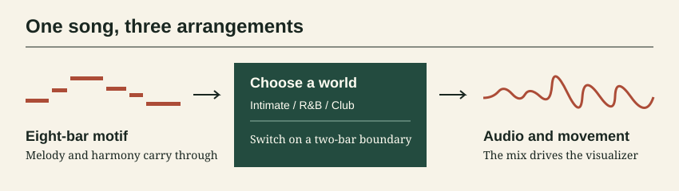

# Music Universe

Explore one original song through three interactive musical worlds in your browser or an offline Mac app.

**[Try Live Demo](https://jeremybboy.github.io/music-universe/)** · [Quick start](#quick-start) · [Song format](docs/muv-format.md) · [Architecture](docs/architecture.md) · [Contributing](CONTRIBUTING.md)



Play **Afterimage**, then move among Intimate (84 BPM), R&B (95 BPM), and Club (124 BPM). The melody and harmony carry through each arrangement. You can shape the mood, energy, and instrument layers while the visualizer follows the sound.

Use **Discover** to see the song’s identity, authored worlds and allowed transitions, and what’s playing now. Playback continues when you switch between Listen and Discover. Use **Open .muv** to explore a local package or [download the bundled Afterimage package](songs/Afterimage.muv) from the repository.

Use [Song Analysis](docs/song-analysis.md) to inspect a local Audio Analyst report. [Strudel Player](docs/strudel-player.md) opens a rendition of Afterimage’s Intimate world in the official web REPL.

## Quick start

### Mac app

Build once on macOS 14 or newer with Node.js 24 or newer and the Xcode command line tools:

```sh
npm ci
npm run build:macos
open "dist-macos/Music Universe.app"
```

After the build, double-click **Music Universe.app** to launch it. The app bundles the player and runs offline with no development server or Node process. The build targets the architecture of your Node install and applies an ad hoc signature for local use.

### Local browser development

With Node.js 24 or newer:

```sh
npm ci
npm run dev
```

Open **http://127.0.0.1:5191** and press **Play**. The local app uses port 5191 so it can run alongside other projects on the default Vite port. After npm installs the development dependencies, the player and dev server can run offline.

Try **“switch to Club”**, **“energy 65%”**, or **“make it more intimate and less percussive”**. The text box applies a small, deterministic set of phrases to the same controls shown on screen. During playback, the new configuration takes effect at a two-bar boundary and the player shows the scheduled bar. When paused, changes take effect immediately.

## Verify

```sh
npm test
npm run pack:muv -- --check
npm run build
```

Reproduce the browser smoke test with installed Google Chrome on macOS:

```sh
MUSIC_UNIVERSE_BROWSER=chrome npm run test:browser
```

Alternatively, run `npx playwright install chromium` once and then `npm run test:browser`. The browser test starts and closes its own loopback server.

## Public web deployment

The [public player](https://jeremybboy.github.io/music-universe/) is a static GitHub Pages site. The Pages workflow verifies builds and browser playback on pull requests. After the owner merges, the workflow deploys the verified web build from `main` and checks the public URL and its assets. The repository uses **Settings → Pages → Build and deployment → Source → GitHub Actions**.

To exercise the production build locally under the Pages subpath:

```sh
npm run build:pages
MUSIC_UNIVERSE_BROWSER=chrome npm run test:browser -- --pages
```

To check the deployed site after the workflow succeeds:

```sh
MUSIC_UNIVERSE_TEST_URL=https://jeremybboy.github.io/music-universe/ npm run test:browser -- --pages
```

## Composition and assets

Afterimage is an authored eight-bar loop in A minor. The melody, harmony, and rhythmic patterns live in the [canonical song data](songs/afterimage). The browser synthesizes each part from those events, and the artwork is drawn in CSS and Canvas. Review [the architecture](docs/architecture.md) for the state model and timing behavior.
